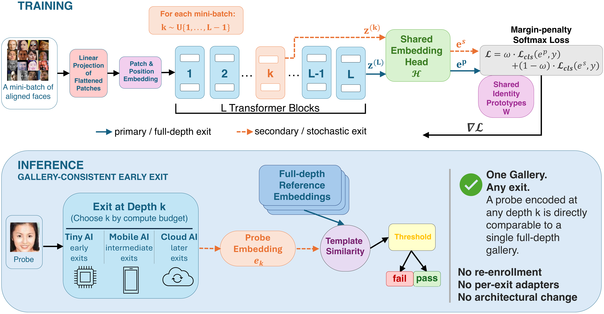

# Stochastic Deep Supervision for Gallery-Consistent Early-Exit Face Recognition

This repository contains the official implementation of the paper **"Stochastic Deep Supervision for Gallery-Consistent Early-Exit Face Recognition"**, accepted at WACV 2027.

[Poster](assets/SD-ViT_poster.pdf) | [Slides](assets/SD-ViT_slides.pdf)

## Overview

**SD-ViT** trains a single Vision Transformer face recognition model whose every block depth is a usable exit. At each training iteration, one intermediate block is sampled uniformly and decoded by the *same* embedding head as the final block, and both embeddings are scored against the *same* class prototypes under the same margin-penalty loss. Because all depths share the head, they share one embedding space: a probe processed at an early exit can be matched directly against a gallery enrolled once at full depth, with no gallery recomputation and no adaptation layers.

### Key Features

- **One model, every budget**: a usable exit at every block depth after a single training run, selected by compute budget at inference time
- **Gallery consistency**: early-exit probes match a gallery enrolled once at full depth by plain cosine similarity
- **One threshold**: a verification threshold calibrated at full depth stays usable from quarter depth onward
- **No overhead at inference**: no teacher, no per-exit heads or adaptation layers, the deployed network is a standard ViT

### Method Overview

<p align="center">
  
  <br>
  <em>A face image is tokenized and processed by L blocks. The full-depth tokens form the primary exit; at each iteration a secondary exit is read out at a uniformly sampled block k ~ U{1, ..., L-1}. Both are decoded by the same head and scored against the same prototypes under a margin-penalty loss, combined with weight ω. At inference a probe may exit at any depth and match a gallery enrolled once at full depth.</em>
</p>

## Results

Self-evaluation at quarter-, half-, and full-depth exits (Tab. 1 of the paper). HQ (5) is the average accuracy over LFW, AgeDB-30, CFP-FP, CPLFW and CALFW, TinyFace is Rank-1, and IJB-C is TAR@FAR=1e-4. *Baseline* is the identical backbone trained identically with supervision at the final exit only.

| Backbone | Data | Method | Exit | GFLOPs | HQ (5) | TinyFace | IJB-C |
|---|---|---|:---:|:---:|:---:|:---:|:---:|
| ViT-S/12 | WebFace4M | Baseline | 3 / 6 / 12 | 4.70 / 9.26 / 18.37 | 63.68 / 77.90 / 97.43 | 40.61 / 56.01 / 74.25 | 11.05 / 42.22 / 96.89 |
| ViT-S/12 | WebFace4M | **SD-ViT** | 3 / 6 / 12 | 4.70 / 9.26 / 18.37 | 93.68 / 96.42 / 97.29 | 64.62 / 71.22 / 73.85 | 87.01 / 95.11 / 96.51 |
| ViT-B/24 | WebFace4M | Baseline | 6 / 12 / 24 | 6.79 / 13.44 / 26.74 | 69.35 / 88.35 / 97.45 | 49.73 / 65.45 / 73.77 | 21.63 / 71.97 / 97.02 |
| ViT-B/24 | WebFace4M | **SD-ViT** | 6 / 12 / 24 | 6.79 / 13.44 / 26.74 | 95.41 / 97.05 / 97.35 | 68.51 / 73.50 / 74.57 | 91.83 / 96.32 / 96.69 |
| ViT-B/24 | WebFace12M | Baseline | 6 / 12 / 24 | 6.79 / 13.44 / 26.74 | 64.46 / 82.69 / 97.75 | 44.21 / 63.17 / 75.78 | 12.10 / 55.93 / 97.69 |
| ViT-B/24 | WebFace12M | **SD-ViT** | 6 / 12 / 24 | 6.79 / 13.44 / 26.74 | 96.38 / 97.42 / 97.67 | 70.04 / 74.41 / 74.60 | 95.03 / 97.06 / 97.56 |

Against a gallery enrolled once at full depth (gallery-fixed, Tab. 5), IJB-C TAR@FAR=1e-4 of ViT-S/12 at exits 3 / 6 / 12 is 0.02 / 34.63 / 96.89 for the Baseline and 93.06 / 95.84 / 96.51 for SD-ViT.

## Installation

SD-ViT is implemented on top of [CVLface](https://github.com/mk-minchul/CVLface), which provides the training framework, the data pipeline and the evaluation toolkit.

1. Set up CVLface by following its README: install the requirements, set `DATA_ROOT` in `CVLface/cvlface/.env`, and download the evaluation benchmarks with its evaluation toolkit. To train, also prepare WebFace4M or WebFace12M as described in its training-data README. This repository does not redistribute any data.

2. Add SD-ViT to your CVLface checkout:
   ```bash
   python install.py --cvlface /path/to/CVLface
   ```
   This copies the files under `run_v1/` into `CVLface/cvlface/research/recognition/code/run_v1` and registers the SD-ViT model (`models/vit_SD`), its training pipeline (`TrainModelSDClsPipeline`) and the `gridsample_v2` augmentation in CVLface's registries. Re-running it is safe.

## Pretrained Models

The SD-ViT models of the paper are available **[here](https://drive.google.com/drive/folders/18UsfqyFC4l6WSq_qPP03SqRG7Ija8MSv?usp=sharing)**. Each model is a folder with `model.pt` and `model.yaml`; place them, e.g., under `CVLface/cvlface/pretrained_models/sdvit/`.

| Model | Backbone | Data | Full-depth GFLOPs |
|---|---|---|:---:|
| `sdvit_vit_s12_wf4m` | ViT-S/12 | WebFace4M | 18.37 |
| `sdvit_vit_b24_wf4m` | ViT-B/24 | WebFace4M | 26.74 |
| `sdvit_vit_b24_wf12m` | ViT-B/24 | WebFace12M | 26.74 |

These are the checkpoints evaluated in the paper. Like every CVLface run, each is the epoch that CVLface keeps as `checkpoints/best`, the one with the best average accuracy on the five high-quality sets over the per-epoch evaluations.

## Evaluation

Run from `CVLface/cvlface/research/recognition/code/run_v1`. `sdvit_eval.py` evaluates a model at every exit (`--exits all`) or at selected ones (`--exits 3,6,12`) under the three protocols of the paper:

```bash
# probe and gallery both embedded at exit k (Tab. 1)
python sdvit_eval.py --ckpt_dir ../../../../pretrained_models/sdvit/sdvit_vit_s12_wf4m --protocol self

# exit-k probe against a gallery enrolled once at full depth (Tab. 5)
python sdvit_eval.py --ckpt_dir ../../../../pretrained_models/sdvit/sdvit_vit_s12_wf4m --protocol gallery_fixed

# one threshold calibrated on full-depth development scores at FAR=1e-4, held fixed at every exit (Tab. 6)
python sdvit_eval.py --ckpt_dir ../../../../pretrained_models/sdvit/sdvit_vit_s12_wf4m --protocol threshold
```

or all three at once with `CVLFACE=/path/to/CVLface bash scripts/eval.sh /path/to/sdvit_vit_s12_wf4m`. Use `--num_gpu` for multi-GPU evaluation. Results are written to `<ckpt_dir>/sdvit_eval/<protocol>/`: the full per-exit results, a summary with the metrics of the paper (IJB-C uses CVLface's `Norm:True_Det:True` setting), and, for the threshold protocol, the realized FAR and TAR per exit together with the pair scores. The benchmarks are listed in `run_v1/evaluations/configs/sdvit.yaml`.

A Baseline checkpoint trained with CVLface's ViT can be passed to the same script: its intermediate blocks are then read through its own head, which is the Baseline (training-free ViT-FREE) read-out of the paper.

## Training

```bash
# SD-ViT, ViT-S/12 on WebFace4M with 4 GPUs (total batch 1024)
CVLFACE=/path/to/CVLface bash scripts/train.sh vit_s12_wf4m 4

# other configurations: vit_s15_wf4m, vit_b24_wf4m, vit_b24_wf12m
# Baseline (same backbone and settings, supervision at the final exit only)
CVLFACE=/path/to/CVLface bash scripts/train.sh vit_s12_wf4m 4 baseline
```

All models are trained with the settings below; the per-GPU batch size is 1024 divided by the number of GPUs.

| Setting | Value |
|---|---|
| Loss | AdaFace (m=0.4, h=0.333) with PartialFC (sampling rate 0.6) |
| Weight of the full-depth term ω | 0.7 |
| Optimizer | AdamW, lr 1e-4, weight decay 0.05 |
| Schedule | 40 epochs, cosine with 3 warm-up epochs |
| Batch size | 1024 |
| Augmentation | CVLface grid-sample augmentation applied with probability 0.5 (`gridsample_v2`) |
| Seed | 2048 |

After every epoch the five high-quality sets are evaluated and CVLface keeps the epoch with the best average as `checkpoints/best`.

## Citation
```
@inproceedings{ozgur2027sdvit,
  author    = {Guray Ozgur and
               Tahar Chettaoui and
               Eduarda Caldeira and
               Naser Damer and
               Fadi Boutros},
  title     = {Stochastic Deep Supervision for Gallery-Consistent Early-Exit Face Recognition},
  booktitle = {IEEE/CVF Winter Conference on Applications of Computer Vision (WACV)},
  year      = {2027}
}
```

## Acknowledgement
This implementation builds on [CVLface](https://github.com/mk-minchul/CVLface) (MIT License, Copyright (c) 2022 Minchul Kim). Files adapted from it are marked as such.

## License
>This project is licensed under the terms of the **Attribution-NonCommercial-ShareAlike 4.0 International (CC BY-NC-SA 4.0)** license.  
Copyright (c) 2026 Fraunhofer Institute for Computer Graphics Research IGD Darmstadt  
For more details, please take a look at the [LICENSE](./LICENSE) file.
